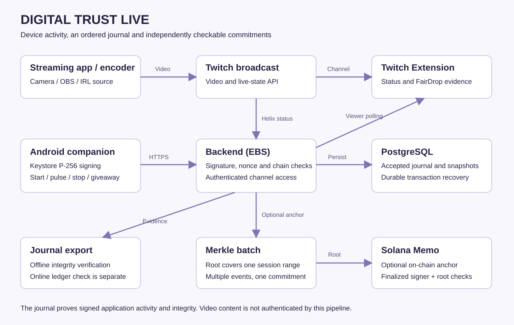
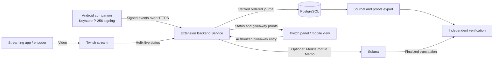
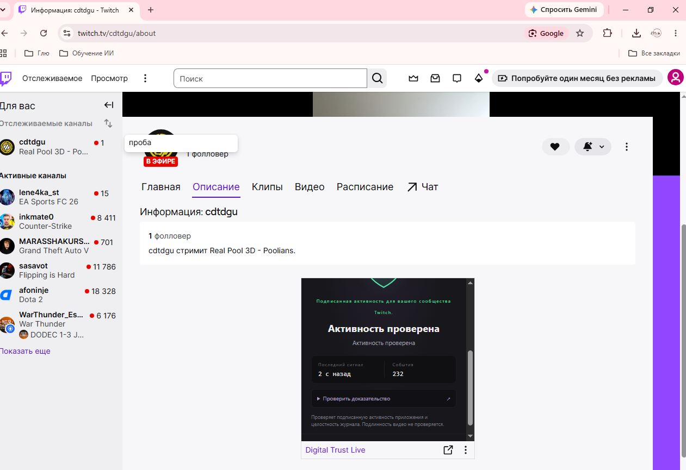
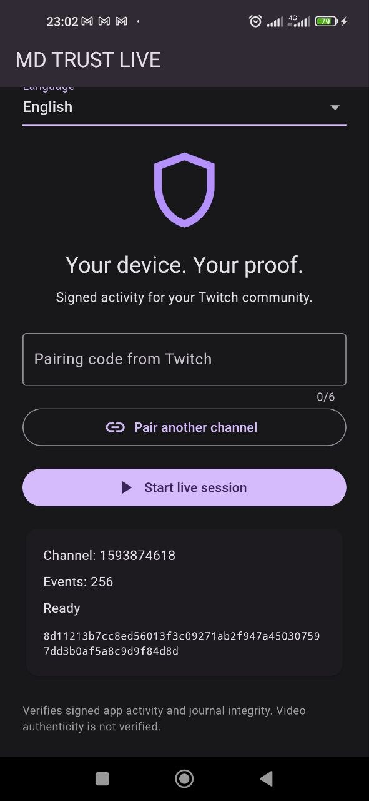
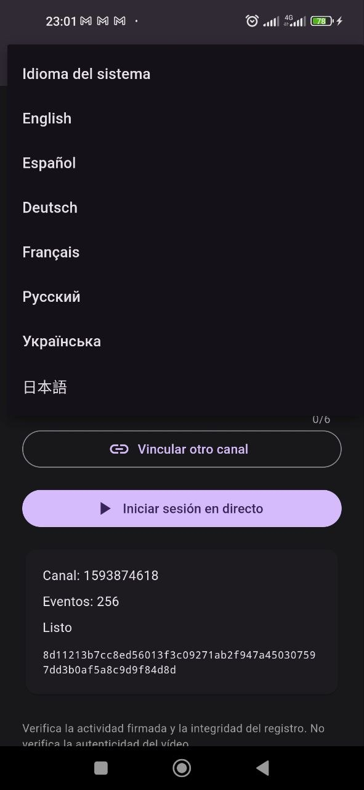

# Digital Trust Live

**Signed activity and verifiable giveaway results for Twitch.**

Digital Trust Live (displayed as **MD Trust Live** on Android) connects an Android companion, a Twitch Extension and an Extension Backend Service (EBS). A device signs an ordered activity journal; the backend checks signatures and continuity; viewers see the resulting status inside Twitch. FairDrop adds committed, reproducible giveaway results. Optional Solana anchoring publishes a Merkle root covering a range of journal events.

The video stream travels directly through Twitch. The companion signs activity records; it does not record, sign or authenticate the video itself.

## Architecture





See [the detailed event sequence and trust boundaries](docs/ARCHITECTURE.md).

## Implemented capabilities

| Capability | What it does | Why it exists |
| --- | --- | --- |
| Channel/device pairing | Broadcaster requests a six-digit code, valid for five minutes; Android pairs its signing identity with the channel | Keeps device enrollment separate from viewer access |
| Device signing | P-256 ECDSA signatures use an Android Keystore private key | Attributes accepted records to the enrolled device |
| Live session journal | Records `SESSION_START`, recurring `PULSE` and `SESSION_END` | Makes session continuity inspectable |
| Hash chaining | Canonical JSON and SHA-256 link each record to the previous record | Detects alteration and ordering inconsistencies |
| Challenges and replay controls | Short-lived server nonces and timestamp checks protect signed requests | Limits replay of previous requests |
| Reliable delivery | Persists signed records and retries identical payloads idempotently | Recovers from interrupted responses without duplicate events |
| Twitch-aware viewer status | Combines journal integrity, pulse freshness and Twitch live status | Separates an active device session from an actual Twitch broadcast |
| FairDrop | Open, enter, freeze, lock, reveal and publish a deterministic result with inclusion evidence | Lets viewers check a result against the committed seed and participant set |
| Evidence export | Exports the journal and proof data; provides an offline verifier | Allows checks outside the extension UI |
| Solana anchoring | Builds a Merkle tree for a session event range and sends its root in a Memo transaction | Provides an external commitment to a batch of records |
| Durable anchor delivery | Stores prepared transaction bytes before broadcast and recovers the same transaction | Makes delivery recoverable across interruptions |
| Seven languages | English, Spanish, German, French, Russian, Ukrainian and Japanese; system detection and manual choice | Supports viewers and creators in their preferred language |

The Android foreground service exposes session start/stop controls. Pulses are scheduled approximately every five seconds after the previous operation completes, so the number of recorded events can grow during an otherwise quiet stream. **These pulses are activity records, not donations, chat messages or giveaway wins.**

Automatic anchoring is disabled by default (`ANCHOR_ENABLED=false`). A signed event is not automatically an on-chain transaction. An anchor covers multiple events, and an on-chain claim requires checking the transaction on the configured network.

FairDrop demonstrates reproducibility against a committed seed and frozen entries. It is not a claim that every possible influence over a giveaway has been eliminated.

## Screenshots from the working demonstration



*Twitch viewer panel in Russian: verified activity, pulse freshness and the accepted event count. The surrounding video and channel page belong to Twitch.*



*Android companion in English, paired with a channel and ready to start a session. The displayed event count belongs to its journal.*



*Manual language selection, including all seven supported languages.*

## Using the product

1. The operator deploys the backend and configures the Twitch Extension once.
2. The broadcaster installs and activates the extension on their Twitch channel.
3. In the extension configuration, the broadcaster requests a pairing code and enters it in the Android companion.
4. The broadcaster starts their Twitch broadcast using their streaming software and starts a device session in MD Trust Live.
5. Viewers open the channel's extension panel or supported mobile extension view. They do not provide developer secrets or deploy a server.
6. For a giveaway, the creator opens FairDrop; viewers authorize identity sharing when required and enter; the creator locks entries and reveals the result.
7. Evidence can be exported and checked independently. Ledger verification is a separate check from offline journal verification.

## Repository

```text
app/       Flutter interface and native Android signing/session service
ebs/       TypeScript backend, database migrations and tests
panel/     Twitch configuration, panel and mobile extension views
shared/    Translation sources
tools/     Migration, verification and development utilities
deploy/    Container deployment configuration
docs/      Protocol, architecture, product context and economics
```

Start with [setup](docs/SETUP.md), [protocol specification](docs/SPEC.md), [architecture](docs/ARCHITECTURE.md), [product context](docs/PRODUCT_CONTEXT.md) and [economic scenarios](docs/ECONOMICS.md).

See [validation results](docs/VALIDATION.md) for the checks performed on this publication snapshot.

## Current scope and next steps

The implemented path covers signed device activity and FairDrop. Donation receipts, external donation-provider ingestion, chat-event attestations and evidence-vault media capture are future integrations; they are not represented as active features. See [the donations roadmap](docs/DONATIONS_ROADMAP.md).

The supplied demonstration used Twitch Hosted Test and Android. Public Twitch availability depends on Twitch review and release. Production APK distribution also requires the operator's release signing and distribution process.

## Licensing and secrets

Copyright 2026 Yurii Ivanov.

Original project contributions in this distribution are available for noncommercial use under the license in [LICENSE](LICENSE). This is **source-available, noncommercial licensing**, not an OSI open-source license. See [third-party notices](THIRD_PARTY_NOTICES.md) for preserved upstream rights.

Real `.env` files, wallets, API secrets, signing keys and access documents must remain outside version control. Examples contain configuration names, not production credentials.
