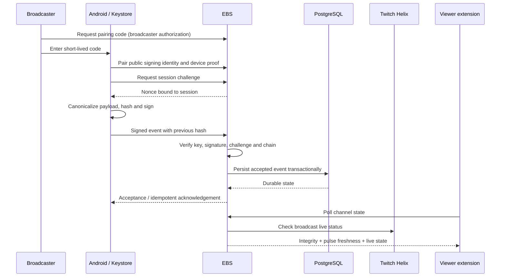
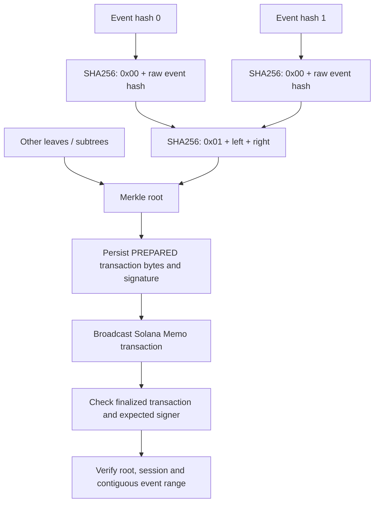

# Architecture and verification

## Signed record flow

## Merkle anchoring

Trees follow the RFC 6962 domain-separated construction. Non-power-of-two trees split at the largest lower power of two. A journal leaf contains the raw 32-byte event hash. Giveaway entry leaves use `MDTL-ENTRY-1\n{giveaway_id}\n{user_id}`. The Memo format is `MDTL1|sessionUUID|from|to|root`.

The current anchor groups events **within one session**. A shared tree across all channels is a proposed optimization, not the current on-chain format.

## Trust boundaries

- Android Keystore retains the device private key; the backend receives its public identity and signatures.
- The backend enforces pairing, nonce freshness, authentication and journal continuity, and persists state in PostgreSQL.
- Twitch authorization establishes broadcaster/viewer context. Twitch live state is checked separately from a device pulse.
- Solana stores the commitment, not the video, full journal or a donation receipt. The backend wallet signs the anchoring transaction.
- Offline export verification checks the supplied cryptographic evidence. It does not itself query the ledger; online verification checks finalized chain evidence separately.

## FairDrop lifecycle

`OPEN -> FROZEN -> LOCKED -> COMPLETE` (seed reveal and result)

The creator commits a seed before the result is determined. Viewers enter under their Twitch identities, with one accepted entry per identity. The backend freezes the sorted entry set; a signed lock records its count and Merkle root. Reveal checks the seed commitment and derives the winner deterministically. The result includes evidence that can be independently recomputed.

## Status and scale

The viewer polls on a three-second interval, with failure backoff up to thirty seconds. A fresh pulse alone is insufficient for a green live status: journal integrity and a positive Twitch live response are also required. The freshness thresholds are fifteen seconds and ninety seconds; ended or stale sessions do not remain green indefinitely.

Current storage and polling grow with usage. Caching, bounded retention and platform-wide aggregation require explicit capacity planning. A compact Merkle root reduces ledger payload; it does not eliminate ingestion, persistence or proof-generation work.
